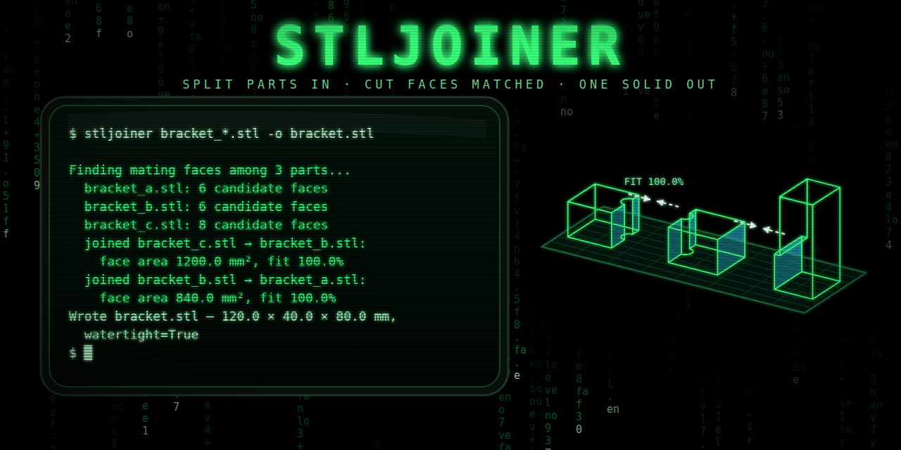
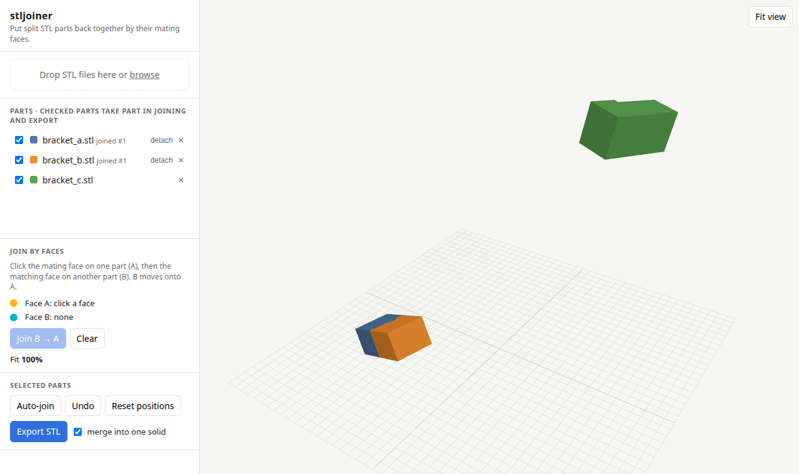

# stljoiner



[](https://github.com/drak42/stljoiner/actions/workflows/ci.yml)
[](https://github.com/drak42/stljoiner/blob/main/LICENSE)
[](https://buymeacoffee.com/drak42)

Put split STL parts back together by matching the faces where they were cut, and save them as **one watertight solid**.

Did you cut a model to fit your print bed, or download one that came in pieces? stljoiner finds the faces that mate, moves each piece into place, even if it's scattered and rotated, and merges everything.


**New here? Start with the [user guide](docs/USER_GUIDE.md).**

## Features

- **Web interface:** drop parts in, click the two faces that touch, and the piece snaps into place. View in 3D and export with one click.
- **Pick which parts to use:** unchecked parts are faded out and left out of joining and export.
- **Exact alignment:** outlines are matched by shape (holes count), then snapped vertex to vertex, so seams close without gaps.
- **Symmetric faces:** if a cut face fits more than one way, **Next rotation** steps through every way it fits.
- **Auto-join:** finds the joints by itself. It works best for pieces still in their original positions or cut faces with unique shapes.
- **One clean solid out:** a boolean union with [manifold3d](https://github.com/elalish/manifold), with seam vertices welded first.
- **Command line** for scripts and batches.

## Install

You need Python 3.10 or newer. The easiest way is [pipx](https://pipx.pypa.io/), which gives stljoiner its own environment:

```bash
pipx install stljoiner
```

`pip install stljoiner` works too, as does `uv tool install stljoiner`. Upgrade later with `pipx upgrade stljoiner`.

## Web interface

```bash
stljoiner web          # then open http://127.0.0.1:4300
```



1. Drop your STL parts in. Only **checked** parts can be picked, joined or exported.
2. Click the mating face on one part (**A**, yellow), then the matching face on another part (**B**, cyan), and press **Join B → A**.
3. If it's turned the wrong way, press **Next rotation**.
4. Repeat until everything is joined, then **Export STL**.

Use `stljoiner web --port 4301` to choose another port. The page is served on this computer only (`127.0.0.1`).

## Command line

```bash
stljoiner part1.stl part2.stl part3.stl -o joined.stl
```

| Option | Meaning |
|---|---|
| `-o FILE` | Output file (default `joined.stl`). |
| `--no-union` | Place the parts but don't merge them into one solid. |
| `--export-parts DIR` | Also write each repositioned piece. |
| `--tolerance 0.05` | How closely mating faces must match (fraction). |
| `--max-faces`, `--min-area` | Which flat faces count as cut candidates. |
| `--version`, `-q` | Show the version, or run quietly. |

## How it works

1. Finds the flat faces on each part. Flat islands on the same plane count as one face, as happens when a cut passes through a hole.
2. For a pair of faces, turns B's face to point against A's, then searches the in-plane rotation for the best outline overlap (IoU, holes included).
3. Refines the match with 2D ICP on the outline vertices, so the faces line up exactly.
4. Joins parts along the best matches (each face used once), moving whole groups together.
5. Welds the seam vertices and unions everything into one manifold mesh.

## Known limitations

- Auto-join (and the command line) only goes by face shape. A cut face with a symmetric outline, such as a rectangle, can fit more than one way. An end face elsewhere on the part with the same shape as a cut can also be mistaken for it. In the web interface, pick the faces yourself.
- For reliable automatic results, export the pieces at their original positions (most slicers' cut tools can), or use connectors (dowels, keys) so each joint is unique.
- Pieces should be watertight. Repair them first if the merge fails.

## Documentation

- [User guide](docs/USER_GUIDE.md): a friendly walkthrough of the web interface and the command line.
- [Changelog](CHANGELOG.md)
- [Contributing](CONTRIBUTING.md)
- [Security](SECURITY.md)

## Support

stljoiner is free and open source. If it saves a print or two, you can [buy me a coffee](https://buymeacoffee.com/drak42) ☕. Bug reports, ideas and pull requests are just as welcome: see [CONTRIBUTING.md](CONTRIBUTING.md).

## License

[MIT](LICENSE) © 2026 Christopher Eslick
