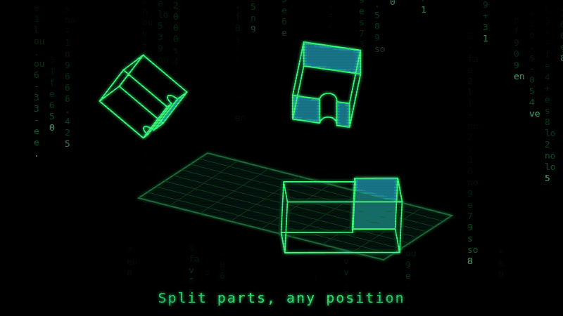

# stljoiner


[](https://pepy.tech/projects/stljoiner)
[](https://github.com/drak42/stljoiner/actions/workflows/ci.yml)
[](https://github.com/drak42/stljoiner/blob/main/LICENSE)
[](https://buymeacoffee.com/drak42)

Put split 3D-print parts back together by matching the faces where they were cut, and save them as **one watertight solid**. Reads and writes STL, 3MF, OBJ, PLY, OFF and GLB.

Did you cut a model to fit your print bed, or download one that came in pieces? stljoiner finds the faces that mate, moves each piece into place, even if it's scattered and rotated, and merges everything.



**New here? Start with the [user guide](https://github.com/drak42/stljoiner/blob/main/docs/USER_GUIDE.md).**

## Features

- **Web interface:** drop parts in, click a cut face, and stljoiner suggests the face it mates with. One more key press snaps the piece into place.
- **Works offline:** the 3D viewer ships inside the package. Nothing is loaded from the internet.
- **Pick which parts to use:** unchecked parts are faded out and left out of joining and export.
- **Exact alignment:** outlines are matched by shape (holes count), then snapped vertex to vertex, so seams close without gaps.
- **Connectors and shaped cuts:** pegs and holes, stepped cuts and dovetails are matched too.
- **Symmetric faces:** if a cut face fits more than one way, **Next rotation** steps through every way it fits.
- **Auto-join:** finds the joints by itself. It never pushes one part into another, and it warns you when a joint is a guess.
- **Fine-tune:** move or turn a part (and everything joined to it) by any step.
- **One clean solid out:** a boolean union with [manifold3d](https://github.com/elalish/manifold), with seam vertices welded first. You can also keep the parts as separate objects in a 3MF for multi-color printing.
- **Light or green-screen theme**, and keyboard shortcuts for everything.
- **Command line** for scripts and batches.

## Install

You need Python 3.10 or newer. The easiest way is [pipx](https://pipx.pypa.io/), which gives stljoiner its own environment:

```bash
pipx install stljoiner
```

`pip install stljoiner` works too, as does `uv tool install stljoiner`. Upgrade later with `pipx upgrade stljoiner`.

## Web interface

```bash
stljoiner web          # then open http://127.0.0.1:4300
```


1. Drop your parts in (STL, 3MF, OBJ, PLY, OFF or GLB). A 3MF or GLB holding several objects loads as several parts. Only **checked** parts can be picked, joined or exported.
2. Click the cut face on one part (**A**, yellow). The best-fitting faces on the other parts light up cyan and are listed with their fit.
3. Press **S** to take the top suggestion (or click any face yourself), then **J** to join. Part B snaps onto part A.
4. If it's turned the wrong way, press **N** (**Next rotation**). Use **Adjust** to move or turn a part by hand.
5. Repeat until everything is joined, then **Export** as STL, 3MF, OBJ, PLY or GLB.

Press **?** in the page for all the keyboard shortcuts.

Use `stljoiner web --port 4301` to choose another port. The page is served on this computer only (`127.0.0.1`).

## Command line

```bash
stljoiner part1.stl part2.stl part3.stl -o joined.stl
stljoiner kit.3mf -o joined.3mf                        # every object in the 3MF is a part
stljoiner a.stl b.stl --no-union -o placed.3mf         # placed, kept as separate objects
```

| Option | Meaning |
|---|---|
| `-o FILE` | Output file (default `joined.stl`). Its extension picks the format: `.stl`, `.3mf`, `.obj`, `.ply`, `.off`, `.glb`. |
| `--no-union` | Place the parts but don't merge them. 3MF and GLB keep each part as its own object. |
| `--export-parts DIR` | Also write each repositioned piece. |
| `--tolerance 0.05` | How closely mating faces must match (fraction). |
| `--max-faces`, `--min-area` | Which flat faces count as cut candidates. |
| `--version`, `-q` | Show the version, or run quietly. |

## How it works

1. Finds the flat faces on each part. Flat islands on the same plane count as one face, as happens when a cut passes through a hole.
2. For a pair of faces, turns B's face to point against A's, then searches the in-plane rotation for the best outline overlap (IoU, holes included).
3. Refines the match with 2D ICP on the outline vertices, so the faces line up exactly.
4. Groups face matches that agree on the same placement, so a stepped or dovetailed cut, made of several flat faces, counts as one strong joint. A plain face that fits many partners is trusted less than one that fits only one.
5. Joins parts best joint first (each face used once, whole groups moving together), and skips any joint that would push one part into another.
6. Welds the seam vertices and unions everything into one manifold mesh.

## Known limitations

- Auto-join (and the command line) only goes by shape. When a plain face, such as the end of a rectangular bar, has exactly the same outline as a cut face, nothing in the geometry tells them apart. stljoiner then flags the joint with ⚠ so you can check it. In the web interface, click the cut face and take the suggestion instead.
- For reliable automatic results, export the pieces at their original positions (most slicers' cut tools can), or use connectors (pegs, dowels, keys) or a shaped cut so each joint is unique.
- Cuts must be made of flat faces (straight, stepped or dovetailed). Curved cut surfaces aren't matched.
- Pieces should be watertight. Repair them first if the merge fails.

## Documentation

- [User guide](https://github.com/drak42/stljoiner/blob/main/docs/USER_GUIDE.md): a friendly walkthrough of the web interface and the command line.
- [Changelog](https://github.com/drak42/stljoiner/blob/main/CHANGELOG.md)
- [Contributing](https://github.com/drak42/stljoiner/blob/main/CONTRIBUTING.md)
- [Security](https://github.com/drak42/stljoiner/blob/main/SECURITY.md)

## Companion projects

Two more free tools from the same author, for the steps after joining:

- **[BlendSVG](https://github.com/drak42/blendsvg)** cuts SVG artwork into a model as flush colour inlays, as a 3MF with one part per colour. A Blender add-on, with a command line.
- **[BatchSlicer](https://github.com/drak42/batch_slicer)** slices one model or whole folders with your own OrcaSlicer, Bambu Studio or Creality Print presets, matches multi-colour parts to the filaments loaded in a Creality CFS, and sends the G-code to Klipper or OctoPrint. `pipx install batchslicer`.

### How they fit together

The three cover one path, from a model to G-code on the printer. Each works on
its own; use the steps you need.

```
 a model in pieces        your own artwork             the printer
        │                       │                           ▲
   stljoiner  ─────────►   BlendSVG   ─────────►   BatchSlicer
 rejoin split parts      flush colour inlays     slice with your presets,
 into one solid          from an SVG, as a       match the CFS, send to
 (or separate parts      multi-part 3MF          Klipper or OctoPrint,
  for multi-colour)                              watch folder, web page
```

- **stljoiner → BlendSVG**: a model cut to fit the bed, or downloaded in
  pieces, is joined into one watertight solid (STL), ready to decorate.
- **BlendSVG → BatchSlicer**: BlendSVG's 3MF has the model on filament 1 and
  each colour of the artwork on filaments 2, 3, …; BatchSlicer slices it with
  one `--filament` per part, in that order, and sends it to the printer
  (tested with OrcaSlicer; Bambu Studio's command line puts every part on the
  first filament).
- **stljoiner → BatchSlicer**: a kit that came in pieces is joined and
  sliced; drop the joined file into BatchSlicer's watch folder, or its web
  page, to have it sliced and sent. With `--no-union`, stljoiner keeps the
  pieces as separate objects in a 3MF, to give each its own colour in the
  slicer.

## Support

stljoiner is free and open source. If it saves a print or two, you can [buy me a coffee](https://buymeacoffee.com/drak42) ☕. Bug reports, ideas and pull requests are just as welcome: see [CONTRIBUTING.md](https://github.com/drak42/stljoiner/blob/main/CONTRIBUTING.md).

## License

[MIT](https://github.com/drak42/stljoiner/blob/main/LICENSE) © 2026 Christopher Eslick
