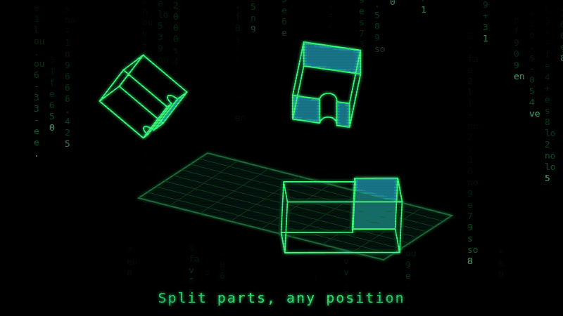
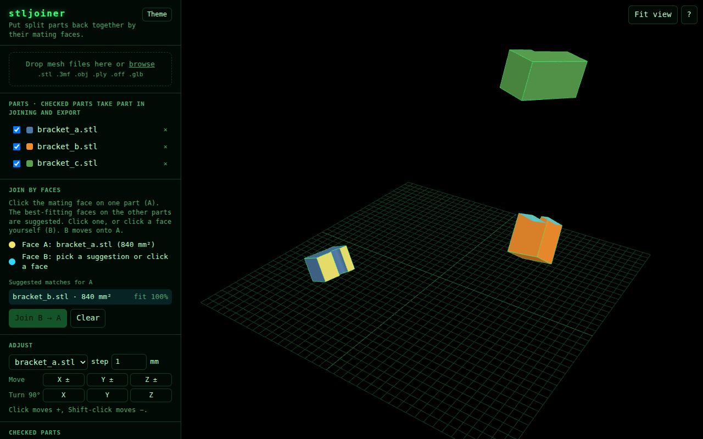

# stljoiner user guide



Did you split a model to fit your print bed, or download a model that came in pieces, and now want it back as one part? stljoiner puts the pieces back together by matching the faces where they were cut, then saves them as a single solid. It reads and writes STL, 3MF, OBJ, PLY, OFF and GLB files.

This guide covers the web interface first, since it's the easiest way to use stljoiner. The command-line version is covered near the end.

---

## Setting up (one time)

You need Python 3.10 or newer. Install stljoiner with [pipx](https://pipx.pypa.io/), which keeps it in its own tidy environment:

```bash
pipx install stljoiner
```

No pipx? `pip install stljoiner` works too. To update later: `pipx upgrade stljoiner`.

## Starting the app

```bash
stljoiner web
```

Then open **http://127.0.0.1:4300** in your browser.

> Everything runs on your own computer, with no internet connection needed. Your files never leave your machine: they go only to the app running locally.

To stop the app, press `Ctrl+C` in the terminal.

---

## A quick tour of the screen



| Area | What it's for |
|---|---|
| **Theme** (top left) | Switches between the light look and the green-screen look. Your choice is remembered. |
| **Drop zone** | Add files by dragging them in or clicking *browse*. |
| **Parts list** | Every loaded piece, with its color in the 3D view. |
| **Join by faces** | The faces you've picked, suggested matches, and the **Join B → A** button. |
| **Adjust** | Move or turn a part by hand. |
| **Checked parts** | Auto-join, Undo, Reset positions and Export. |
| **3D view** (right) | Your parts. Drag to orbit, right-drag to pan, scroll to zoom. **Fit view** brings everything back into frame, and **?** lists the keyboard shortcuts. |

---

## Joining your parts, step by step

### 1. Add your pieces

Drag all the pieces onto the drop zone or the 3D view. Each one gets its own color. STL, 3MF, OBJ, PLY, OFF and GLB files all work. A 3MF or GLB that holds several objects (a whole kit, say) loads as one part per object.

A ⚠ next to a name means that piece has holes in its mesh. It can still be joined, but merging into one solid may not work cleanly. Repairing the piece in your slicer or mesh tool first helps.

### 2. Choose which parts to work with

Each part in the list has a checkbox. **Only checked parts are used.** Unchecked parts:

- are faded out in the 3D view,
- can't be clicked,
- are left out of Auto-join and Export.

This is handy when you've loaded extra pieces, or several models at once, and want to focus on just the ones that go together. Your checkboxes are remembered if you reload the page.

### 3. Pick the two faces that touch

1. Click the **cut face** on the first part. It lights up **yellow**. This is face **A**, and this part stays still.
2. stljoiner looks at the other checked parts and **suggests the faces that fit best**. They glow cyan in the 3D view, even through other parts, and appear in a list with their fit. The best one is at the top.
3. Click a suggestion in the list or press **S** to take the top one. You can also click any face in the 3D view yourself. This is face **B**, and its part will move.
4. Press **Join B → A** (or **J**).

Part B jumps into place against part A. Any parts already joined to B move along with it.

**Tips for picking faces:**
- Orbit around until you can see the flat cut face clearly, then click it.
- Picked and suggested faces show through the model, so you can always see where they are.
- If the cut went through a hole or slot, the face may be split into several flat pieces. Click any one of them and stljoiner selects them all.
- Clicked the wrong face? Click again to start over, or press **Clear** (or `Esc`).

### 4. Fix the rotation if needed

Some cut faces look the same when turned around. A rectangle, for example, fits two ways and a square fits four. If your part lands upside down or turned the wrong way:

- Press **Next rotation** under the Join button to step through every way the faces fit. The button only appears when a face fits more than one way.
- The **Fit %** shows how well the faces line up. A correct cut usually reads 100%.

### 5. Fine-tune by hand (optional)

The **Adjust** panel moves a part, and everything joined to it, by hand:

- Choose the part in the drop-down. It switches to the part you last clicked.
- Set the **step** in millimeters.
- **Move X/Y/Z** moves by one step. Hold **Shift** while clicking to move the other way.
- **Turn 90° X/Y/Z** turns it a quarter turn around its center. Hold **Shift** to turn the other way.

### 6. Repeat for the remaining pieces

Keep picking pairs of faces until everything is connected. Joined parts show a **joined #** label in the list.

### 7. Export

Choose a format (STL, 3MF, OBJ, PLY or GLB) and press **Export** (or **E**).

- With **merge into one solid** ticked (the default), you get one clean solid, such as `joined.stl`, ready for your slicer.
- Untick it to keep the pieces separate. As **3MF** or **GLB**, each piece stays its own object, all in the right place. That's handy for printing each part in a different color.

---

## Letting stljoiner guess: Auto-join

**Auto-join** tries to work out every joint among the checked parts by itself. It works well when:

- the pieces are **still in their original positions**, for example if you exported them from your slicer's cut tool without moving them, or
- every cut face has a **unique shape**, for example with dowel holes, pegs or a jagged cut.

It also handles **stepped cuts and dovetails**: when several flat faces agree on the same placement, that joint wins. It never pushes one part into another.

It can be fooled when a piece has a plain face exactly the same shape as a cut face, such as both ends of a rectangular bar. When that happens, the status line marks the joint with **⚠**. If Auto-join gets something wrong, press **Undo** and join those parts by picking faces yourself. The suggestions make that quick.

---

## Other handy buttons

| Button | What it does |
|---|---|
| **Undo** | Steps back one change (up to 50). |
| **Reset positions** | Puts every part back where it was in its original file and separates all joins. |
| **detach** (in the parts list) | Separates one part from its group without moving it. |
| **✕** (in the parts list) | Removes a part from the session. |
| **Fit view** | Zooms the 3D view to fit the checked parts. |
| **Theme** | Switches between the light and green-screen looks. |

### Keyboard shortcuts

| Key | Does |
|---|---|
| `J` | Join B → A |
| `S` | Take the top suggestion as face B |
| `N` | Next rotation |
| `A` | Auto-join the checked parts |
| `Ctrl+Z` | Undo |
| `F` | Fit view |
| `E` | Export |
| `T` | Switch theme |
| `Esc` | Clear the picked faces |
| `?` | Show the shortcuts in the page |

---

## Troubleshooting

**"Those parts are already joined together"**
Both faces you picked belong to the same group. Pick face B on a part that isn't joined to A yet, or **detach** one first.

**The part landed in a strange spot.**
You probably picked a face that isn't the real cut face. A part's end or top can be the same size as the cut. Press **Undo** and pick again.

**It's the right face but turned the wrong way.**
Press **Next rotation**.

**The exported file isn't a single solid / my slicer complains.**
This usually means one of the pieces had holes in its mesh (look for ⚠ in the parts list). Repair the piece and try again, or export with **merge into one solid** unticked.

**No suggestions appear.**
None of the other checked parts has a face of a similar size and shape. Check that the part you want is ticked, or click face B yourself.

**The 3D view is blank.**
Reload the page. If it stays blank, your browser may have WebGL turned off. Try another browser.

**Port 4300 is already in use.**
Start the app on another port, for example `stljoiner web --port 4301`.

---

## Using the command line instead

To join files without the browser:

```bash
stljoiner part1.stl part2.stl part3.stl -o joined.stl
```

This works like Auto-join, with the same strengths and limits. Some more examples:

```bash
stljoiner kit.3mf -o joined.3mf                    # every object in the 3MF is a part
stljoiner a.stl b.stl --no-union -o placed.3mf     # placed, kept as separate objects
```

Useful options:

| Option | Meaning |
|---|---|
| `-o FILE` | Output file name (default `joined.stl`). The extension picks the format: `.stl`, `.3mf`, `.obj`, `.ply`, `.off` or `.glb`. |
| `--no-union` | Place the parts but don't merge them. In a 3MF or GLB, each part stays its own object. |
| `--export-parts DIR` | Also save each repositioned piece separately. |
| `--tolerance 0.05` | How closely faces must match (5% by default). Raise it a little if matching faces have small differences. |
| `-q` | Quiet mode. |

---

## Tips for best results

- **When splitting a model, keep the pieces in place** when you export them. stljoiner then rejoins them perfectly with no guessing.
- **Use connectors** (pegs, dowels, keys) or a **stepped or dovetail cut**. They give each joint a unique shape, so the right match is obvious.
- **Make sure each piece is watertight** before joining. Most slicers can repair meshes.

---

## Enjoying stljoiner?

It's free and open source. If it rescued a print, you can [buy me a coffee](https://buymeacoffee.com/drak42) ☕. Found a bug or have an idea? [Open an issue](https://github.com/drak42/stljoiner/issues/new/choose). Attaching the STL pieces helps the most.
